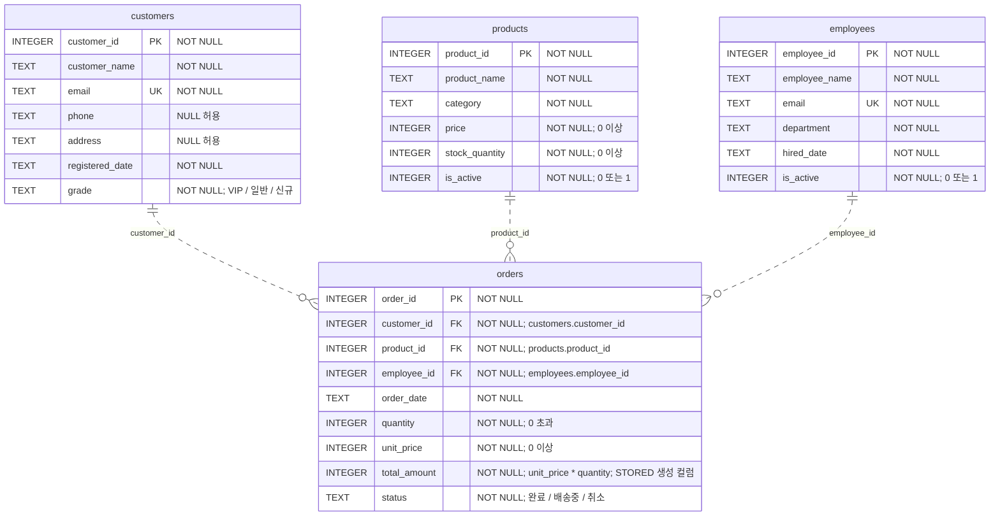

# customer.db ERD

`customer.db`의 실제 SQLite 스키마(`table_xinfo`, `foreign_key_list`, 인덱스 및 테이블 정의)를 기준으로 작성했습니다.

- `PK`: 기본키, `FK`: 외래키, `UK`: 고유키(UNIQUE).
- 고객·상품·직원과 주문은 각각 **1:N** 관계입니다. 각 주문은 고객·상품·직원을 반드시 하나씩 참조하며, 각 고객·상품·직원은 주문을 0개 이상 가질 수 있습니다(`||..o{`).
- 점선은 비식별 관계를 뜻합니다. 주문의 기본키는 `order_id`이며, 외래키 3개는 기본키에 포함되지 않습니다.
- 외래키 3개 모두 `ON DELETE RESTRICT`입니다. 주문에서 참조 중인 고객·상품·직원은 삭제할 수 없습니다(외래키 검사 활성화 시).
- 날짜 컬럼은 SQLite에 `TEXT`로 저장됩니다. 모델과 시드 코드의 날짜 형식은 `YYYY-MM-DD`입니다.
- 주문 금액은 DB가 `unit_price * quantity`로 계산해 저장합니다. 상품 가격과 주문 단가의 일치는 시드 코드가 보장하며, DB 제약조건으로 강제되지는 않습니다.
